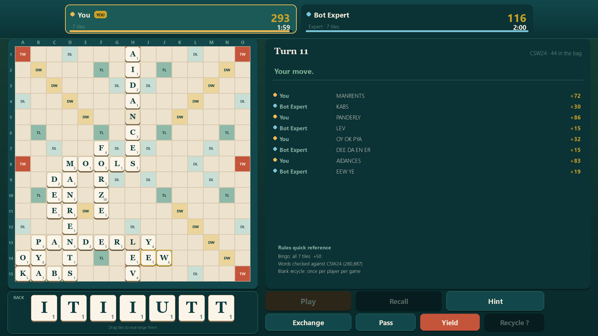
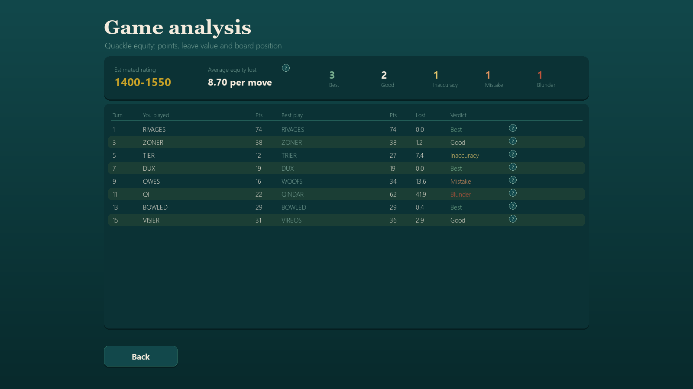
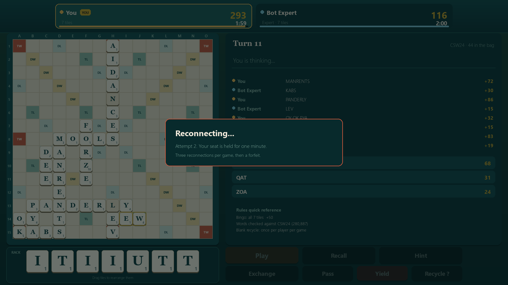
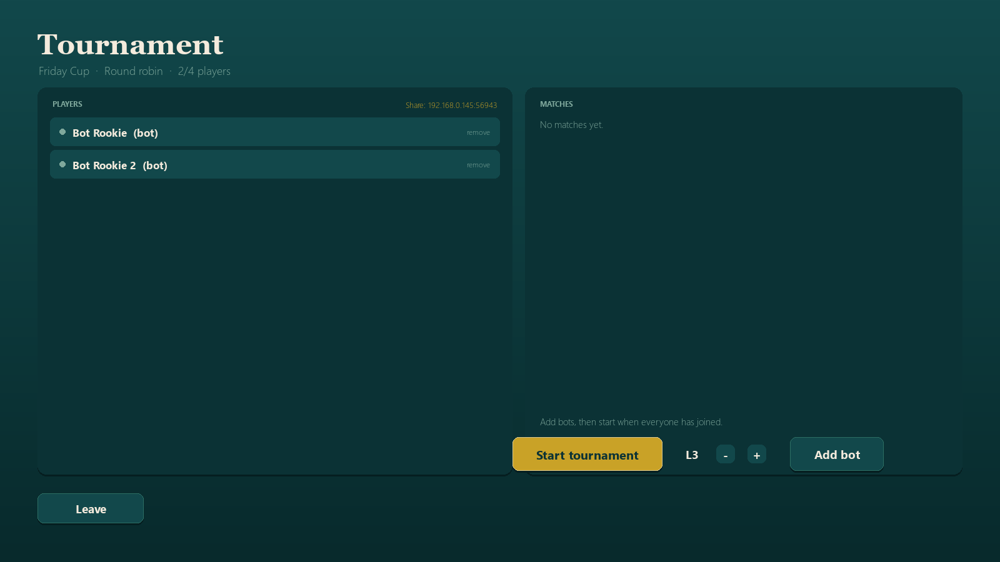
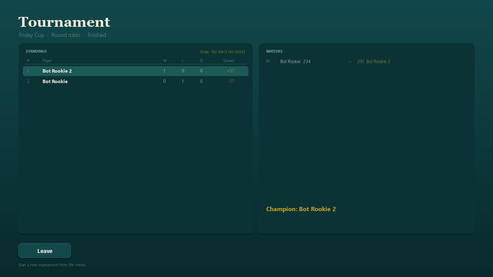

# Tessera

A desktop word game for Windows, in the Scrabble family: you against
Quackle-powered bots, or two to four people over the internet with a server
hosted by one of the players. Anyone else can watch.



See [COMPARISON.md](COMPARISON.md) for how Tessera sits beside Woogles, the Internet
Scrabble Club, Scrabble GO and UniWords.

## What is in the box

- **Full standard rules** on the 15x15 board, with scores and turn clocks
  across the top, your rack at the bottom and Exchange / Pass / Yield buttons
  next to it.
- **Both word lists**, chosen per game:
  - **CSW24** - Collins Scrabble Words 2024, the current official list,
    280,887 words (34,919 more than the old list; 723 old words removed).
  - **SOWPODS** - the legacy 2007 list, 246,691 words, for playing old
    club games or watching old replays.
  - **ENABLE** - the free public-domain list, 168,551 words of 2-15 letters.
    This is what the Store build ships, because the Collins lists cannot be
    redistributed publicly. It has no ZA, QI or OK.
  - **Your own list** - import any A-Z list in Settings; Tessera compiles it for
    the engine itself, so the rules and the bots always agree.
  The Python rules check against `data/<list>.txt`, and the Quackle engine loads
  the matching `<list>.dawg`.
- **Quackle engine** compiled in as a local helper (`engine/qengine.exe`). It
  supplies the move generation, leave evaluation, simulation and endgame play
  behind five bot strengths.
- **Turn clocks** of 1, 1.5, 2 or 3 minutes. The clock flashes red for the last
  ten seconds and the turn is passed automatically when it runs out.
- **Scales cleanly**: the board is drawn on a fixed canvas and smoothly scaled
  to the window, so full screen is crisp rather than pixelated.
- **House rules**: blank recycling, bingo bonus, six-scoreless-turn ending and a
  shortest-word limit can each be switched by the host.
- **Tournament-style board**: A-O / 1-15 coordinates, gold centre star, and the
  last move highlighted (both toggleable).
- **Word list identity**: the chosen list's SHA-256 is checked against the known
  CSW24 / SOWPODS files and shown as VERIFIED in Settings; free lists read
  BUILT IN and imports read CUSTOM LIST.
- **Online play** for 2-4 players, with any number of spectators. The host runs
  the game server inside the game and shares an address such as
  `192.168.1.20:5467`. Everyone needs this game installed.
- **Drops are survivable**: a lost connection has a minute to come back, three
  times per game, before that player forfeits.
- **Game analysis** with Quackle after every match: best play per turn, equity
  lost, and a verdict for each move.
- **Tournaments**: Swiss, round robin or knockout, run by the host's server.
  One match at a time on a shared board; everyone else watches, then the
  leaderboard updates.

## Running it

| What | How |
| --- | --- |
| Normal start | double-click `Tessera.bat` |
| Start with a console (shows errors) | double-click `run_game.bat` |
| From a terminal | `F:\Python312\python.exe -m tessera` in this folder |

The game uses Python 3.12 (installed at `F:\Python312`) with `pygame`. It is
already installed on this machine. For another machine:

```bat
F:\Python312\python.exe -m pip install pygame
```

## Playing

1. **Play against the computer** - pick your name, 1-3 bot opponents (each with
   its own skill level), a turn clock, the word list and whether blank recycling
   is allowed.
2. Click a rack tile, then click a square. Click a placed tile to take it back.
   Drag and drop also works.
3. **Play** sends the move once it is legal. The panel on the right shows the
   words and the score before you commit, plus the move log.
4. **Hint** asks the engine (championship settings) for the three best plays.
   Clicking a suggestion lays it on the board for you.
5. **Exchange**, **Pass** and **Yield** are below the board. Exchange needs at
   least seven tiles in the bag. Yield ends the match and hands it to the
   opponent.
6. **Recall** takes every pending tile back. To reorder your rack, drag a tile
   sideways and drop it where you want it - there is no shuffle button, the rack
   is yours to arrange.

Scoring uses the normal premium squares: TW, DW, TL and DL. Playing all seven
tiles adds 50. Blanks score nothing. When the bag is empty and someone plays
out, they collect the value of everyone else's leftover tiles; six scoreless
turns in a row also ends the game.

### Bot levels

| Level | Engine | Feel |
| --- | --- | --- |
| Rookie | static evaluation, deliberately cheap play | beginner: short low-scoring words, misses bingos, sometimes swaps tiles, no blocking |
| Casual | static evaluation, mostly best play | improving player: solid words, weak leaves |
| Club | 20-second simulator | club player |
| Expert | 5-minute simulator, capped | strong leaves and endgame |
| Master | championship simulator, capped | as strong as it gets |

Low levels do not just take a lower-ranked Quackle move - those are all still
good. Rookie and, less often, Casual deliberately settle for a play scoring 14
or fewer points while a much better one is available, ignore seven-tile plays,
and sometimes swap tiles for no good reason. That is what makes them beatable
rather than merely slower. `tools/test_bot.py` checks that gap so it cannot
quietly drift back.

## Game analysis

When the match ends, **Analyse my play** on the results screen reviews every
move you made with Quackle:

- The best play Quackle would have chosen, its points and its equity.
- What you played, its points and equity.
- The equity you gave up, and a verdict: Best, Good, Inaccuracy, Mistake or
  Blunder.
- A summary: average equity lost per move, how many of each verdict, and a
  rough rating band.
- A small **?** at the end of every line. Hover over it and it explains that
  verdict: what the band means, how much equity the move gave up, what Quackle
  would have played and what you played, with points and equity.

Equity is Quackle's score for a play: points plus the value of the tiles left on
your rack plus board position. Both sides are measured the same way, so the
"lost" column is a fair comparison. The analysis runs on the host's machine
(the same machine for a local game) and only covers your own moves; it never
reveals anyone's rack.



## Display

Windowed or full screen, chosen in Settings and remembered. The layout is
1600x900 (16:9), so full screen on a 1920x1080 or 2560x1440 display fills the
screen exactly with no bars. It is drawn on a fixed canvas and scaled with a
smooth filter, so it stays sharp on high-DPI screens; mouse positions are mapped
back to the canvas. Only unusual aspect ratios (ultrawide, 16:10) show thin
margins.

## Settings

The **Settings** button on the menu opens two groups:

**This computer** (yours, saved immediately)

- Name used when you host or join.
- Full screen on or off.
- Highlight the last move on the board.
- Show A-O / 1-15 board coordinates.
- Default port for hosting.

**Match rules** (the host's call)

- Clock per turn, 1 to 3 minutes.
- Word list: CSW24, SOWPODS, ENABLE or an imported list, with a badge
  (VERIFIED / BUILT IN / CUSTOM LIST) and the SHA-256 fingerprint.
- Shortest allowed word: any, 3+, 4+ or 5+.
- Bingo bonus (+50 for seven tiles), on or off.
- End after six scoreless turns, on or off.
- One blank recycle per player, on or off.
- Hints allowed, on or off. With hints off the Hint button is disabled for
  everyone.

With no game running these act as defaults for the next game. In a hosted lobby
the host can change them live and everyone sees the change. Once a match starts
they are locked, and a guest sees them read-only. Press Esc during a game to open
Settings; the match rules appear greyed out.

## Online games

1. The host chooses **Host an online game**, sets seats (2-4), the clock and the
   rules, then **Create server**.
2. The lobby shows the address to share, for example `192.168.1.20:5467`. A
   public IP is fetched too when the internet is reachable.
3. Friends choose **Join an online game**, type that address and their name,
   then **Join game** for a seat or **Spectate** to watch.
4. The host can fill empty seats with bots and presses **Start match**.

Notes:

- Windows Firewall may ask to allow the game. Allow it on private networks.
- Over the internet, forward the TCP port (default 5467) on the host's router,
  or share the public IP and port if the router supports UPnP mapping. Without
  that, the address only works on the same network.
- The host is authoritative: the server validates every move, keeps the clocks
  and runs the bots. If the host closes the game the match stops.
- Every player sees the board, scores, clocks, tile counts and the move log.
  Only your own rack is visible to you.
- Spectators join with **Spectate**; they see the board, scores, clocks and the
  move log but no racks, and cannot play. They can join a lobby or a match in
  progress, and the lobby shows how many are watching.

### If the connection drops

A dropped player is not thrown out straight away. Their seat is held, marked
**away**, and the other players are told no more than that. The game keeps the
place open for **60 seconds** while the match underneath carries on (the clock
still runs, as it does for anyone thinking too long). The client retries by
itself every couple of seconds, with a red-edged "Reconnecting..." card over the
board. If it gets back inside the minute the player is put straight back in
their seat, with their rack, score and turn intact.

A player may do this at most **three times per game**. If they are still away
when the minute is up, or the three returns are used, they **forfeit**:

- In a two-player game the match ends there and the other player wins.
- In a three- or four-player game the forfeiter's turns are skipped, their tiles
  score against them at the end, and everyone else carries on.
- In a tournament the match goes to the opponent as a walkover, and the player
  is out of the tournament.

Spectators can rejoin too, with no limit. A lobby place left empty past the
minute simply frees up again.



## Tournaments

**Host a tournament** on the menu turns the host's server into a competition.
You choose the name, format, Swiss round count, places (4, 6, 8, 12 or 16),
the clock, the word list and blank recycling, then create it. Friends join with
the same address they use for an online game, and empty seats can be filled
with bots (level 1-5) so you can run one solo.

| Format | How it works |
| --- | --- |
| Swiss | A fixed number of rounds. Each round players are paired on wins, then spread, avoiding rematches where possible. |
| Round robin | Everyone meets everyone once. |
| Knockout | Single elimination. Lose and you are out; a drawn match is replayed. |

How it runs:

- **One match at a time.** The two drawn players play on the normal board;
  everyone else, including the host, watches the same board live and cannot
  place tiles. The header shows round and turn, and who is playing whom.
- Between matches there is a short pause, then the tournament board returns with
  the result added to the ladder.
- **Leaderboard** columns: rank, player, wins, losses, draws and spread (points
  for minus points against). Sorted on wins, then spread, then points scored.
- A bye counts as a win. A drawn knockout match is replayed rather than
  knocking both players out.
- **Leaving.** A dropped player has the same minute to come back as anywhere
  else, three times per match. Past that they forfeit: the match in progress is
  awarded to the opponent, and so is any match still to come for them. They
  stay on the ladder marked as out, so the rest of the tournament carries on.
- The host presses **Start tournament**; after that the ladder advances itself.
  Closing the host's game ends the tournament.
- The clock, word list and blank recycling are set on the tournament setup
  screen; the other house rules (shortest word, bingo bonus, six scoreless
  turns, hints) come from Settings.





## Your own word lists

Settings has **Import a word list** under the word-list card. Pick a plain text
file (one word per line, or a `.dic`, `.list` or `.words` file) and Tessera:

1. reads it, uppercases it and keeps 2-15 letter A-Z words;
2. compiles it into a Quackle dictionary itself, so the engine and the rules use
   exactly the same words;
3. copies it to `%APPDATA%\Tessera\wordlists\` and adds it to every word-list
   chooser in the game.

A list needs at least 500 usable words. A list of 280,000 takes a couple of
seconds to compile, once. **Remove list** appears when an imported list is
selected; built-in lists cannot be removed. Imported lists are marked CUSTOM
LIST and stay on your machine only - they are not sent to other players, so in
an online game everyone should be using the same list by name.

## Microsoft Store

`tools\build_msix.py` builds a Store package: `dist\Tessera.msix` (about 30 MB).
It uses the Store build (`dist\store\Tessera`), which ships ENABLE only, draws the
Store logos, writes `AppxManifest.xml` and packs the result with `makeappx`.

```bat
F:\Python312\python.exe tools\build_exe.py --store
F:\Python312\python.exe tools\build_msix.py
```

`makeappx.exe` comes from the Windows SDK; this machine keeps a copy in
`F:\toolchains\msix` (the folder must stay together - the tool needs the DLLs and
manifests beside it). Without it the layout is still written to
`dist\msix\layout`, which you can register in Developer Mode:

```bat
Add-AppxPackage -Register F:\Tessera\dist\msix\layout\AppxManifest.xml
```

Before submitting:

1. Open a developer account at <https://storedeveloper.microsoft.com> (free for
   individuals and companies), then reserve the name **Tessera**.
2. Copy the package **Name** and **Publisher** Partner Center gives you into the
   build, for example:
   `set TESSERA_STORE_NAME=12345Smith.Tessera` and
   `set TESSERA_STORE_PUBLISHER=CN=0A1B-...`, then rebuild.
3. Make sure the listing does not use the Scrabble name or board art, and say it
   is an unofficial fan game.
4. Write a privacy policy and enter its URL. The Store requires one for Desktop
   Bridge / Win32 apps; yours needs to say the game stores settings locally and
   sends game moves only to the host you connect to.
5. Upload `dist\Tessera.msix` in Partner Center. The Store re-signs it, so no
   certificate is needed.

Things the Store package does differently: it is installed under
`C:\Program Files\WindowsApps`, settings still go to `%APPDATA%\Tessera`, and it
asks for the `privateNetworkClientServer` capability so hosting a game works.
Hosting from a Store install is the one thing worth testing on a clean machine
before you publish.

Quackle is GPL v3, so the Store listing has to keep offering the source (this
folder) and the licence. That is normal - VLC is in the Store on the same terms.

## Packaged build

`dist/Tessera/Tessera.exe` is a self-contained build (Python, pygame,
Quackle engine, dictionaries). Copy the whole `dist/Tessera` folder - friends
only need `Tessera.exe` inside it. Rebuild with:

```bat
F:\Python312\python.exe tools\build_exe.py
```

Check a build without opening a window:

```bat
dist\Tessera\Tessera.exe --selftest
rem then read %TEMP%\tessera_selftest.log
```

## Project layout

```
tessera/             the game
  board.py           board, premium squares, word and score checking
  rules.py           racks, bag, turns, scoring, end of game
  lexicon.py         the word-list registry, imports and identity hashes
  dawg.py            builds Quackle DAWG files from any word list
  analysis.py        post-game review helpers
  engine.py          bridge to the Quackle process
  bot.py             five bot personalities
  session.py         lobby, clocks, bot turns (authoritative)
  tournament.py      formats, pairing, byes, ladder, auto-progression
  net/               server, client and line protocol
  ui/                pygame screens, widgets and theme
engine/
  qengine.exe        compiled bridge (game <-> libquackle)
  quackle/           libquackle sources + qengine.cpp
  obj/               build objects
data/
  csw24.dawg         Quackle dictionary (CSW24)
  sowpods.dawg       legacy SOWPODS dictionary
  CSW24.txt          CSW24 word list used for validation
  SOWPODS.txt        legacy word list used for validation
  strategy/          Quackle evaluation data (leaves, worths)
  alphabets/         Quackle alphabet files
assets/              app icon and brand assets
  app.ico            Windows icon used for the packaged exe
  icon.png           window icon
engine/              Quackle bridge and sources
tools/               build and test scripts
  build_msix.py      Store package (manifest, logos, makeappx)
  make_dawg.py       compile a word list into a Quackle DAWG
shots/               screenshots used in this README
```

## Rebuilding the engine

The bridge needs MinGW-w64 g++ (installed at `F:\toolchains\mingw64`) and the
libquackle sources, which are already copied into `engine/quackle`:

```bat
F:\Python312\python.exe tools\build_engine.py
```

That compiles the libquackle translation units (incrementally, into
`engine/obj`) and links `engine/qengine.exe`, then copies the MinGW runtime DLLs
next to it. The engine speaks a tiny line protocol; see the header of
`engine/quackle/qengine.cpp`.

## Tests

```bat
F:\Python312\python.exe tools\test_rules.py       rem scoring, validation, endgame
F:\Python312\python.exe tools\test_bot.py        rem engine startup and move generation
F:\Python312\python.exe tools\sim_game.py        rem two bots play a full game
F:\Python312\python.exe tools\test_net.py        rem two clients plus a spectator
F:\Python312\python.exe tools\test_about.py     rem About/licences screen renders, menu has eight buttons
F:\Python312\python.exe tools\test_settings.py   rem settings screen and persistence
F:\Python312\python.exe tools\test_analysis.py   rem EVAL and the move review
F:\Python312\python.exe tools\test_display.py    rem full screen and scaling
F:\Python312\python.exe tools\test_clock.py      rem timeout passes the turn
F:\Python312\python.exe tools\test_ui_flow.py    rem place, play, hint, pass through the UI
F:\Python312\python.exe tools\test_full_game.py  rem a whole game through the UI
F:\Python312\python.exe tools\test_tournament.py rem pairing, formats, ladder, forfeits
F:\Python312\python.exe tools\test_tournament_ui.py rem tournament server, client and screens
F:\Python312\python.exe tools\test_reconnect.py   rem held seat, three returns, then a forfeit
F:\Python312\python.exe tools\screenshot.py      rem render screens to shots/
```

## Credits and licensing

- **Quackle** - crossword game AI by Jason Katz-Brown, John O'Laughlin and
  contributors, GPL v3. Source is bundled under `engine/quackle`. The game links
  Quackle's library, so the combined work is distributed under the GPL v3.
- **CSW24 / Collins Scrabble Words 2024** - word list copyright HarperCollins.
  Included for personal play and study, not for redistribution: the Store build
  leaves it out.
- **ENABLE** - the Enhanced North American Benchmark Lexicon, compiled by Alan
  Beale and released for free use. Ships with the Store build.
- **pygame** - LGPL.
- **Brand assets and palette** - the icon, wordmark and ink/cream/gold colour
  scheme come from the WPF Tessera project in `F:\OpenCode\Projects\Tessera`.
- Scrabble is a trademark of Mattel and Hasbro. Tessera is an independent
  word game with no connection to either company. The GPL v3 licence permits
  commercial use, so charging for it on the Store is allowed.
